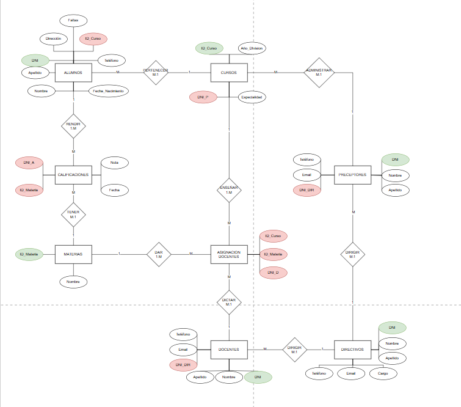
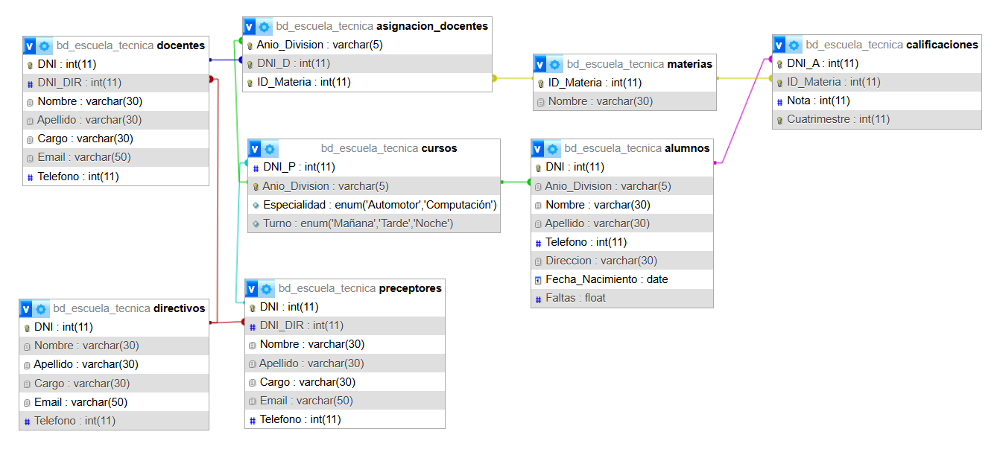

# Base de datos de una escuela técnica

Base de datos en MySQL para gestionar la información académica de una escuela técnica con dos especialidades, Computación y Automotores: alumnos, cursos, materias, calificaciones, docentes, preceptores y directivos.

Trabajo práctico grupal de **Administración y Gestión de Bases de Datos** (5° 1°, ciclo lectivo 2025) en la Escuela Técnica N° 35 "Ing. Eduardo Latzina".

## Sobre el proyecto

Lo hicimos en 2025 y fue mi primer proyecto con una base de datos de este tamaño: 8 tablas relacionadas entre sí, más de 400 alumnos y más de 10.000 calificaciones de prueba, además de triggers, funciones, procedimientos, vistas y usuarios con distintos permisos.

Fue un trabajo en grupo de cinco, así que además de la parte técnica tuvimos que organizarnos: repartirnos las tareas y coordinar para que lo que hacía cada uno encajara en una sola base que funcionara completa.

## El problema

La escuela necesita centralizar los registros de alumnos y personal, que hoy están dispersos y hacen difícil controlar la asistencia, las calificaciones, la asignación de docentes y armar reportes. El objetivo es reducir los errores de carga manual y facilitar el seguimiento académico y administrativo de cada estudiante.

### Supuestos

- Cada alumno pertenece a una sola especialidad y cursa en un único curso/división.
- Un docente puede dictar varias materias en distintos cursos.
- Cada preceptor puede tener a cargo una o más divisiones.
- Los directivos tienen cargos únicos.
- Hay materias comunes a ambas especialidades y otras exclusivas de cada una.
- Las personas se identifican por su DNI.
- Se considera un ciclo lectivo anual.

Quedan afuera de esta etapa los sectores que no forman parte de la estructura académica, como la oficina de alumnos, el gabinete psicopedagógico o la cantina.

## Modelo

**Diagrama entidad-relación**



**Modelo relacional**



| Tabla | Qué guarda |
|---|---|
| `Directivos` | Rector, vicerrector, regentes y demás cargos directivos. |
| `Docentes` | Profesores y suplentes, cada uno con el directivo a cargo. |
| `Preceptores` | Preceptores, cada uno con el directivo a cargo. |
| `Cursos` | Año y división, especialidad, turno y preceptor. |
| `Materias` | Materias que se dictan en la escuela. |
| `Asignacion_Docentes` | Qué docente dicta qué materia en qué curso. |
| `Alumnos` | Datos personales, curso y cantidad de faltas. |
| `Calificaciones` | Nota de cada alumno por materia y cuatrimestre. |

## Qué incluye

Los scripts están en [`sql/`](sql), numerados en el orden en que hay que ejecutarlos:

| Archivo | Contenido |
|---|---|
| `01_estructura.sql` | Creación de la base `bd_etn` y sus 8 tablas. |
| `02_triggers.sql` | 2 triggers de validación: notas entre 1 y 10, y faltas no negativas. |
| `03_inserts.sql` | Datos de prueba: 432 alumnos, 25 docentes, 37 materias y más de 10.000 calificaciones. |
| `04_funciones.sql` | 3 funciones: promedio de un alumno, porcentaje de asistencia y cantidad de alumnos por curso. |
| `05_procedimientos.sql` | 4 procedimientos: notas de un alumno, carga de una calificación, preceptores por curso y docentes por directivo. |
| `06_vistas.sql` | 2 vistas: promedio por alumno y personas a cargo de cada directivo. |
| `07_cursores.sql` | 2 procedimientos con cursores: total de faltas de un curso y promedio por materia. |
| `08_consultas.sql` | 20 consultas, cada una con una explicación de para qué sirve. |
| `09_usuarios.sql` | 3 usuarios con distintos permisos: alumno (lectura de alumnos, cursos, materias y calificaciones), profesor (lectura general y carga de notas) y directivo (control total). |

Debajo de cada consulta o llamada está, como comentario, el resultado que devolvió al ejecutarla.

Los datos de prueba son ficticios.

## Cómo ejecutarlo

Hace falta MySQL o MariaDB. Desde la carpeta del repo, ejecutá todos los scripts en orden con:

```bash
cat sql/*.sql | mysql -u root -p --default-character-set=utf8mb4
```

O abrilos uno por uno, en orden, desde phpMyAdmin, MySQL Workbench o la consola.

`01_estructura.sql` borra y vuelve a crear la base `bd_etn`, así que se puede ejecutar todo de nuevo desde cero.

## Equipo

- Diaz Diaz, Ignacio Esteban
- Findlay, Juan Ignacio
- Muñoz Kreimer, Juan Ignacio
- Pacheco, Benicio
- Sambon, Martin Hernan